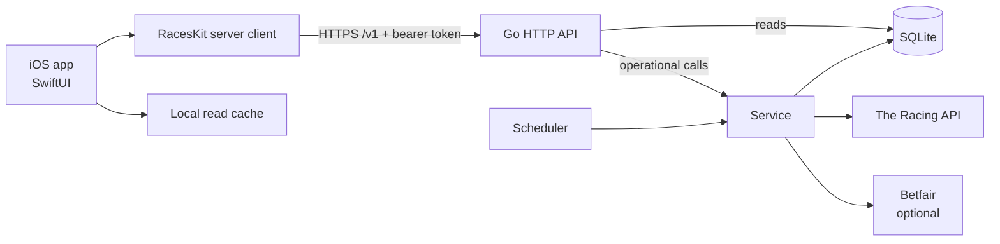
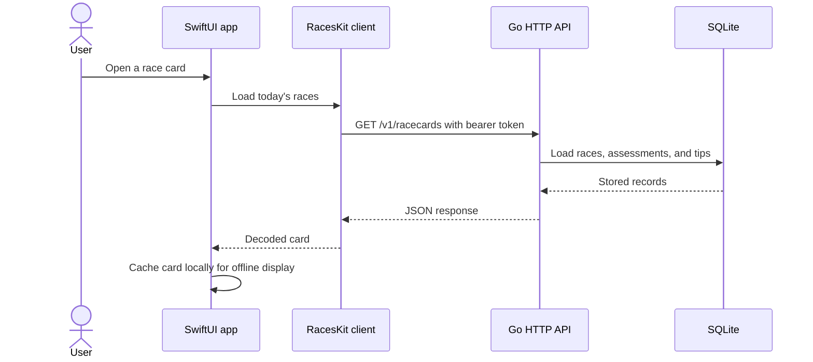
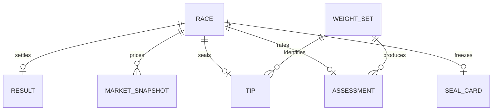

# Architecture

> System design, components, and data flow for Races.

## Overview

Races is a native SwiftUI app backed by a Go service. The service collects racing cards,
market prices, and results on a schedule; it rates races, seals tips, and stores the
resulting history in SQLite. The app reads that shared record over an authenticated HTTP
API and keeps only a local cache.

## Diagram

## Components

| Component | Responsibility | Location |
|-----------|---------------|----------|
| iOS app | SwiftUI screens, view models, Keychain credentials, and a read-only local cache | `apps/ios/Races/Races/` |
| Shared kit | Foundation-only models, HTTP client, response types, and logic tested on Linux | `packages/RacesKit/` |
| HTTP API | Bearer-token authentication and JSON routes. Read routes query the store; operational routes invoke service operations. | `apps/server/internal/api/` |
| Service and scheduler | Provider jobs, race matching, rating, tip sealing, settlement, training, and back-tests | `apps/server/internal/service/`, `matching/`, `rating/`, `tracking/`, `training/`, `backtest/` |
| Provider clients | Rate-limited HTTP clients for racing data and exchange markets | `apps/server/internal/racingapi/`, `betfair/` |
| Storage | SQLite connection, migrations, race history, and saved provider payloads | `apps/server/internal/store/` |
| Composition root | Opens storage, wires providers and services, starts scheduled jobs, and serves HTTP | `apps/server/cmd/races-server/` |

## Request Flow

The app loads a race card from the server. Independently, the server collects and
records data on its schedule.

Scheduled collection fetches cards and results from The Racing API and optional prices
from Betfair. Matching joins provider records; rating and tracking create assessments
and tips; the store persists the data. Tips are sealed with the prices available at seal
time and are not rewritten later.

## Key Decisions

- **The server owns the record.** It schedules collection and stores race history. The
  iOS cache is read-only and never writes records back.
- **Tips preserve their evidence.** The server records the market snapshot and weight-
  set identifier used when a tip is sealed. Back-tests evaluate other weight sets
  without changing recorded tips.
- **Keep the app contract stable.** Go response records follow the matching RacesKit
  `Codable` shapes; fixture tests check server responses and rating parity.
- **Keep shared Swift code platform-free.** `RacesKit` uses Foundation so Linux can test
  its models, networking, and rating logic without an iOS runtime.
- **Treat missing provider access as a normal state.** Betfair is optional. When prices
  are unavailable, the service can record a form-only assessment and report that
  limitation.

## Data Model

The server stores race cards, runners, results, market snapshots, tips, weight sets, and
raw provider payloads in SQLite. `apps/server/internal/domain/models.go` defines the API
and domain records; migrations and persistence live in `apps/server/internal/store/`.

Records are keyed by race ID; full race and result objects are stored as JSON. The
relationships show the main history links rather than database foreign-key constraints.

## External Dependencies

| Service | Purpose | Failure mode |
|---------|---------|--------------|
| The Racing API | Race cards and results | Collection waits for a later scheduled run; provider responses are retained for diagnosis. |
| Betfair | Optional market prices and starting prices | The server records a form-only assessment when market data is unavailable. |
| Homelab Docker host | Runs the server and persists its SQLite data directory | The iOS app reports that the server is unavailable and can show its last cached card. |
